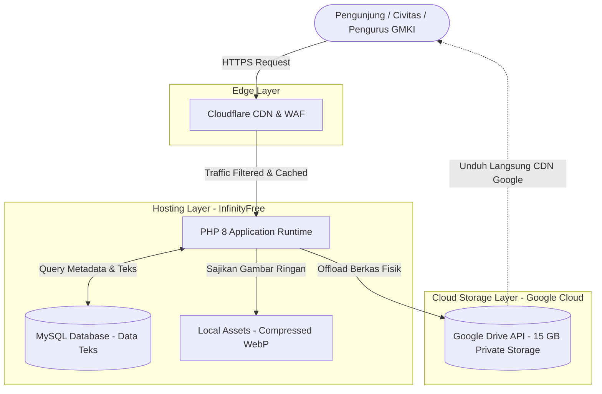

# 🏛️ Cetak Biru Arsitektur Penyimpanan Hibrida (Hybrid Storage Blueprint)
## Sistem Informasi & Manajemen Keanggotaan Terintegrasi - GMKI Cabang Padang

Dokumen ini merumuskan strategi arsitektur penyimpanan terpadu yang memadukan **InfinityFree (Shared Hosting & MySQL)**, **Google Drive API (Cloud Storage 15 GB)**, dan **Cloudflare (Edge CDN & WAF)** agar sistem dapat bertahan dalam jangka panjang (*long-term survival*), kebal terhadap razia pembatasan sumber daya hosting gratis, serta menjamin integritas data organisasi tetap terlindungi 100%.

---

## 1. Landasan Filosofi: Pemisahan Peran (Separation of Concerns)

Prinsip utama arsitektur ini adalah **"Jangan pernah menaruh beban berat pada server gratis"**:



---

## 2. Matriks Pembagian Tingkat Penyimpanan (Storage Tiering)

| Tingkat (Tier) | Komponen Penyimpanan | Jenis Data | Karakteristik & Kebijakan |
| :--- | :--- | :--- | :--- |
| **Tier 1: Relasional & Transaksi** | **MySQL Database** (InfinityFree) | Akun users, biodata civitas, catatan kas, judul laporan, ID referensi berkas. | • Ukuran sangat kecil (< 15 MB).<br>• Kecepatan query milidetik.<br>• Bebas dari penalti CPU limit. |
| **Tier 2: Visual Publik Ringan** | **Local Storage + Cloudflare** (InfinityFree `htdocs`) | Foto sampul berita, foto pengurus BPC, logo cabang, CSS/JS. | • Wajib format WebP terkompresi (< 60 KB).<br>• Di-cache 100% oleh Cloudflare.<br>• Legal di ToS InfinityFree karena elemen web. |
| **Tier 3: Dokumen & Arsip Berat** | **Google Drive API** (Private Folder 15 GB) | Laporan Keuangan Bencab (PDF/Excel), Arsip Surat Sekcab, Berkas Ekspor CSV, PDF KTA. | • **0 MB di disk InfinityFree** (`GDRIVE_OFFLOAD_LOCAL=true`).<br>• Kebal dari bot razia file-hosting.<br>• Diunduh langsung dari CDN Google. |
| **Tier 4: Pemulihan Bencana** | **Google Drive Disaster Recovery** | File cadangan database MySQL mingguan (`.sql`). | • Otomatis tersimpan di Google Drive.<br>• Jika hosting di-suspend, data GMKI tetap utuh. |

---

## 3. Struktur Hierarki Folder di Google Drive

Untuk memastikan data tertata secara profesional dan mudah diaudit oleh Badan Pengurus Cabang (BPC), folder root Google Drive (`1uDzubIf6IYBl6eUwsG8yovv9E5CUol6Z`) diatur dengan hierarki:

```text
📁 GMKI_Padang_Storage/ (Root ID: 1uDzubIf6IYBl6eUwsG8yovv9E5CUol6Z)
│
├── 📁 01_Keuangan_Bencab/
│   ├── 📁 2024/
│   ├── 📁 2025/
│   └── 📁 2026/
│       ├── LPJ_Konfercab_2026.pdf
│       └── Pembukuan_Kas_Triwulan_I.xlsx
│
├── 📁 02_Arsip_Sekcab/
│   ├── Surat_Keputusan/
│   ├── Surat_Masuk/
│   └── Surat_Keluar/
│
├── 📁 03_Ekspor_Rekapitulasi_CSV/
│   └── rekap-keuangan-2026-10-12.csv
│
├── 📁 04_Data_Civitas_KTA/
│   └── Berkas_Pendaftaran/
│
└── 📁 05_Backup_Database_SQL/
    └── backup_gmki_padang_2026_10_12.sql
```

---

## 4. Standar Penamaan Data di Database MySQL (URI Protocol)

Agar aplikasi tidak terikat pada satu penyedia hosting (*vendor-agnostic*), kolom `stored_name` pada tabel database mengadopsi format **Uniform Resource Identifier (URI)**:

* **Untuk Berkas di Google Drive:**
  ```text
  gdrive:{FILE_ID}:{NAMA_BERKAS_ASLI}
  Contoh: gdrive:1wm4b4SGycLd6F8Jy8QAQL6X76TpW-5OL:LPJ_Konfercab.xlsx
  ```
* **Untuk Berkas Lokal (Fallback/Aset Visual):**
  ```text
  local:{NAMA_BERKAS_LOKAL}
  Contoh: local:20261012_abc123.webp
  ```

### Manfaat Format URI:
1. Controller langsung mengetahui tujuan berkas hanya dengan memeriksa awalan `str_starts_with($storedName, 'gdrive:')`.
2. Jika suatu hari cabang beralih ke hosting berbayar atau AWS S3, Anda cukup menambahkan awalan `s3:...` tanpa merusak data lama.

---

## 5. Prosedur Pemulihan Bencana (Disaster Recovery Plan)

> [!IMPORTANT]
> **Skenario Terburuk:** Hosting InfinityFree tiba-tiba mematikan akun karena lonjakan trafik saat kegiatan besar GMKI (Maperca / Konfercab).

Jika skenario terburuk terjadi, berikut langkah pemulihan dalam **kurang dari 15 menit**:

1. **Kode Sumber Aman:** Source code sistem tersimpan rapi di GitHub repository (`EdwardChorintians1604/gmkicabangpadang`).
2. **Dokumen Fisik Aman:** Seluruh dokumen kas, bukti transaksi, dan arsip persuratan tersimpan utuh di Google Drive akun pribadi Anda (`paripurnaerantus2004@gmail.com`).
3. **Database Pulih:** Unduh file cadangan `.sql` terbaru dari folder Google Drive `05_Backup_Database_SQL`.
4. **Luncurkan di Server Baru:**
   * Buat akun baru di hosting mana pun (atau shared hosting lokal murah seharga Rp 15.000/bln).
   * Clone repository dari GitHub.
   * Import file `.sql` ke phpMyAdmin server baru.
   * Salin file `.env` yang sudah siap pakai.
   * **Sistem langsung online kembali tanpa ada 1 byte pun data yang hilang!**

---

## 6. Checklist Pemeliharaan Rutin BPC (Maintenance SOP)

| Frekuensi | Tugas Pengelola Sistem | Estimasi Waktu |
| :--- | :--- | :--- |
| **Harian** | Membiarkan sistem berjalan otomatis (semua dokumen tersimpan langsung ke Google Drive via OAuth2). | 0 menit (Otomatis) |
| **Mingguan** | Melakukan 1x ekspor cadangan database MySQL via menu Admin/BPC dan memastikan masuk ke Google Drive. | 1 menit |
| **Bulanan** | Memeriksa sisa kuota penyimpanan Google Drive (dari total 15 GB, pemakaian biasanya baru < 200 MB per tahun). | 1 menit |
| **Tahunan** | Melakukan audit folder Drive dan memindahkan arsip kepengurusan demisioner ke folder arsip tahunan. | 15 menit |
